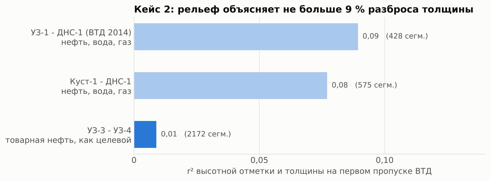
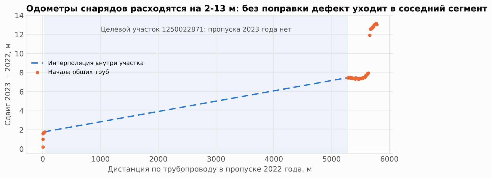
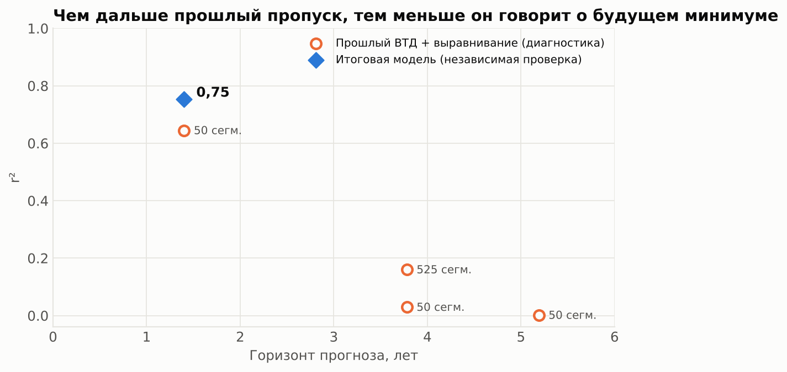

# PipeTwin: прогноз толщины стенки трубопровода по данным ВТД

Решение кейса Nedra Digital на хакатоне. Для каждого 10-метрового сегмента считаем минимальную остаточную
толщину стенки (мм), которую покажет следующий пропуск внутритрубной диагностики.

> **На 14.11.** Пайплайн работает на реальных данных и выдаёт `result.csv` (2 000 строк).
> Кейс 1 проверен независимо: r² 0,75. Кейс 2 проверить напрямую нельзя, ожидаемый r² от 0,01 до 0,1.

## Результат

### Кейс 1: прогноз между пропусками ВТД

Участок `1250022871`, 525 сегментов. Прогнозируем пропуск 2023 года по пропуску 2022 года.

Проверяли на соседнем участке `1250011604`, где известны оба пропуска. Участок делим на пять блоков по десять
сегментов и прячем их по очереди вместе с зазором 10 м. Данные 2023 года спрятанного блока не попадают ни в
оценку сдвига дистанций, ни в закон роста. Это проверяет отдельный тест (`test_heldout_block_does_not_leak`):
если испортить данные спрятанного блока, прогноз для него не меняется.


| Подход | r² | Ошибка, мм | Найдено из 10 % худших |
|---|---|---|---|
| Прошлый ВТД как есть | 0,16 | 0,48 | 1 из 5 |
| Прошлый ВТД, дистанции выровнены | 0,68 | 0,33 | 2 из 5 |
| 5-й перцентиль толщины по дефектам сегмента | 0,74 | 0,60 | 2 из 5 |
| Регрессия по признакам сегмента (вторая модель, | 0,70 | 0,23 | 2 из 5 |
| Модель роста дефектов | 0,69 | 0,21 | 3 из 5 |
| **Итог: модель роста + перцентиль** | **0,75** | **0,20** | **3 из 5** |

Почти весь прирост даёт выравнивание дистанций: одометры снарядов 2022 и 2023 годов расходятся на 2-13 м, и
без поправки дефект попадает в соседний сегмент. Итоговый метод лучше всех базовых и по r², и в миллиметрах.
Но 50 сегментов мало: по блокам r² гуляет от 0,3 до 0,9, и разница между 0,74 и 0,75 случайна.

Вторую модель (регрессию по признакам сегмента) независимо собрал второй участник команды на той же
схеме проверки. Она лучше прошлого ВТД в миллиметрах, но уступает модели роста и в ошибке, и в поиске


Интервал P10-P90 на проверке накрывает 76 % фактов при заявленных 80 %.

Главное, что проверка не покрывает: на целевом участке сдвиг дистанций приходится тянуть на 5 км между
опорами, а в проверке только на 100 м. Эту ошибку мы оценили отдельно (около 1 м) и заложили в прогноз.

### Кейс 2: прогноз от ввода в эксплуатацию

Участок `1250009583`, 1 475 сегментов, ни одного пропуска ВТД. Режим один на весь участок, так что сегменты
различаются только рельефом. Мы проверили, насколько рельеф вообще связан с толщиной, на первых ВТД трёх
других трубопроводов:



| Трубопровод | Продукт | Сегментов | r² высотной отметки | Где стенка тоньше |
|---|---|---|---|---|
| Куст-1 - ДНС-1 | нефть, вода, газ | 575 | 0,08 | на высоких отметках |
| УЗ-1 КПСОД - ДНС-1 (ВТД 2014) | нефть, вода, газ | 428 | 0,09 | в низких местах |
| УЗ-3 КПСОД - УЗ-4 | товарная нефть | 2 172 | 0,01 | на высоких отметках |

По целевому участку идёт товарная нефть, тот же поток, что и по третьему трубопроводу (расход совпадает день
в день). Поэтому высокого r² в кейсе 2 мы не ждём. Основные баллы за `result.csv` приносит кейс 1.

## Как запустить

```bash
pip install -r requirements.txt
python scripts/run_pipeline.py     # 10-20 секунд, данные уже лежат в data/raw/
python scripts/make_figures.py     # графики в outputs/figures/
python -m pytest -q                # 13 тестов на реальных данных, 25-60 секунд
```

`result.csv` появляется в корне, остальные таблицы в `outputs/`. Seed задан в `config.yaml` (`seed: 42`),
повторный запуск даёт тот же файл (это тоже проверяет тест).

Запуск в Google Colab проверен 14.11 (Python 3.13, расчёт 15 с, `result.csv` совпал побайтно). Репозиторий
закрытый, поэтому проще всего так:

1. На странице репозитория в GitHub нажать **Code → Download ZIP**.
2. В Colab открыть панель «Файлы» слева и перетащить туда архив.
3. В ячейке выполнить:

```bash
!unzip -q pipetwin-nedra-main.zip
%cd pipetwin-nedra-main
!pip install -q -r requirements.txt
!python scripts/run_pipeline.py
!python -m pytest -q
```

Все команды запускаются из папки, где лежат `config.yaml` и `requirements.txt`.

## Что делает каждый этап

| Этап | Файл | Что происходит |
|---|---|---|
| 1. Загрузка и очистка | `src/pipetwin/data.py` | Паспорта, профиль, записи ВТД, режим. Отбираем записи потери металла, приводим глубину к процентам, строим сетку сегментов, находим начала труб в каждом пропуске |
| 2. Выравнивание дистанций | `src/pipetwin/pipeline.py`, `align.py` | Сдвиг между пропусками по началам общих труб. Для пропуска 2018 года номера труб не совпадают, там сдвиг ищем по плотности дефектов |
| 3. Модель роста дефектов | `src/pipetwin/case1.py` | Сопоставляем дефекты двух пропусков попарно, оцениваем, как меняется глубина, разыгрываем минимум сегмента методом Монте-Карло |
| 4. Прогноз по рельефу | `src/pipetwin/case2.py`, `features.py` | Сглаженная высотная отметка для участка без ВТД и проверка этого признака на других трубопроводах |
| 5. Сборка и проверка | `src/pipetwin/pipeline.py` | Независимая проверка, точность по горизонтам, прогноз целевых участков, список опасных сегментов |
| 6. Запись | `src/pipetwin/submission.py` | Проверяем формат по сетке из паспорта, а не по самому ответу, и пишем `result.csv` |

### Кейс 1 подробно

Минимум сегмента задаёт самый глубокий дефект, который увидит следующий снаряд. Поэтому считаем на уровне
отдельных дефектов, а не сегментов.

1. **Шкала дистанций.** Снаряд нумерует трубы между кольцевыми швами, и номера в пропусках 2022 и 2023 годов
   совпадают. По началам 57 общих труб сдвиг меряется напрямую: 1,8 м в начале трубопровода и 7,5 м сразу за
   целевым участком. Внутри целевого участка пропуска 2023 года нет, там сдвиг интерполируем линейно.

   

2. **Ошибка интерполяции.** На паре 2018 и 2022 годов сдвиг известен по всему целевому участку. От прямой
   между концами он отходит примерно на 1 м. Эту ошибку разыгрываем в модели: в середине участка прогноз
   сглаживается сильнее, чем у концов.
3. **Закон роста.** На опорных участках дефекты двух пропусков сопоставляем попарно (допуск 8 см по развёртке
   трубы, угол считаем по кругу). По парам видно, как глубина в новом пропуске зависит от старой, сколько
   дефектов не подтверждается и сколько появляется новых.
4. **Розыгрыш.** Закон применяем к 26 тысячам дефектов целевого участка 1 000 раз. Среднее минимума по
   сегменту даёт прогноз, 10-й и 90-й процентили дают интервал.
5. **Ремонты.** В отчёте 2022 года на трёх трубах целевого участка стоит «врезка катушки» со сроком до года,
   там дефекты глубиной 50-56 %. Скорее всего, к 2023 году эти трубы заменили. Так уже было с худшей трубой
   после пропуска 2018 года: в 2022 году на её месте дефектов почти нет. Факта ремонта в данных нет, поэтому
   это сценарий: в каждом розыгрыше каждая из трёх труб заменена новой независимо, с вероятностью 0,8.
   Иначе модель поставила бы на их место минимум всего участка. Как меняется прогноз, если ремонта не было
   или заменили все три трубы, лежит в `outputs/case1_segments.csv` (колонки `if_no_repair`, `if_repaired`):
   в самом тонком сегменте это 3,1 мм против 7,9 мм.
6. **Смесь.** Итог: среднее модели и 5-го перцентиля толщины в стандартизованных единицах. Перцентиль
   устойчивее к шуму отдельного дефекта, модель точнее в миллиметрах.


Чем дальше прошлый пропуск, тем меньше от него пользы. Пропуск 2018 года почти ничего не говорит о минимуме
через 4-5 лет:



Точки для 3,8 и 5,2 года диагностические: там сдвиг ищется по самому целевому пропуску. Независимая
проверка есть только для горизонта 1,4 года.

### Кейс 2 подробно

1. **Что сравнили.** Одиннадцать признаков рельефа: отметку, уклон, кривизну, глубину низин в окнах от 100 м
   до 1 км, расстояние до ближайшей низины, положение вдоль участка. Связь с толщиной есть только у высотной
   отметки, сглаженной в окне 1 км. Мелкие формы рельефа ничего не дают.
2. **Знак не переносится.** На старой обводнённой трубе стенка тоньше в низинах, на двух других трубопроводах
   наоборот. Обученная модель выучила бы знак одной трубы и промахнулась на другой.
3. **Что используем.** Квадрат корреляции от знака не зависит. Поэтому прогноз считаем линейной функцией
   сглаженной отметки: один признак с подтверждённым сигналом, без смеси признаков, которые могут гасить
   друг друга.
4. **Масштаб.** Средняя потеря стенки (около 7 %) и высокая (90-й перцентиль, около 29 %) взяты с первых ВТД
   других трубопроводов. На r² масштаб не влияет.
5. **Чего нет.** Соседний нефтепровод с той же товарной нефтью почти не корродирует: дефекты есть в 4 %
   сегментов, большинство из них заводские. Если целевой участок такой же, его профиль толщины почти ровный,
   с редкими случайными провалами, которые по рельефу не угадать. Границы интервала в кейсе 2 сценарные
   («как у изношенных труб» и «дефектов нет»), это не оценённые процентили. Направление «в низинах тоньше»
   выбрано по физике и влияет только на список опасных сегментов.


## Допущения при очистке данных

| № | Что нашли | Что сделали | Сколько затронуто |
|---|---|---|---|
| 1 | В файле ВТД кроме дефектов есть швы, арматура, вмятины, маркеры | Оставили записи, где есть и остаточная толщина, и глубина | убрано 347 строк из 48 291 |
| 2 | В пропуске 2018 года глубина записана долей (0,18), в остальных процентами | Умножили глубину 2018 года на 100, сверили с остаточной толщиной (тест) | 2 464 строки |
| 3 | Тип дефекта записан по-разному: «внутр.» и «Внутренний» | Свели к одному признаку. В минимум идут и внутренние, и внешние дефекты | все строки |
| 4 | Дистанции одного дефекта в разных пропусках расходятся на 2-13 м | Пропуски 2022 и 2023 годов совмещаем по началам труб, пропуск 2018 года по плотности дефектов | все сравнения пропусков |
| 5 | Есть отрицательные дистанции и записи за концом участка | Относим к первому и последнему сегменту | около 250 строк |
| 6 | В хвосте участка 1250011604 сдвиг прыгает с 7,5 до 13 м на двух трубах под кожухом | Сдвиг берём по началам труб, так что скачок учтён | 2 трубы |
| 7 | Три трубы целевого участка в 2022 году предписано вырезать в течение года | Сценарий: каждая заменена независимо с вероятностью 0,8, варианты 0 и 1 сохранены | 1 153 дефекта, 7 сегментов |
| 8 | У сегмента без дефектов нет остаточной толщины | Берём толщину стенки по записям снаряда, если их нет, то по паспорту | 17 сегментов из 525 на целевом участке |
| 9 | Номер сегмента | `floor(Distance / 10)`, дистанция внутри простого участка, всего `floor(L / 10) + 1` сегментов | |
| 10 | УЗТ: 67 замеров, толщины 11-16 мм при стенке 4,5-8 мм | В модели не используем | |
| 11 | Повторы точек профиля, разный порядок строк в выгрузке | Повторы усредняем, строки сортируем: результат не зависит от порядка | |


## Что лежит в `outputs/`

| Файл | Что внутри |
|---|---|
| `result_with_intervals.csv` | Прогноз с интервалом P10-P90 по каждому сегменту |
| `validation_case1.csv`, `_blocks.csv`, `_points.csv` | Независимая проверка кейса 1: сводно, по блокам, по сегментам |
| `validation_case2.csv` | Сила признака кейса 2 на первых ВТД других трубопроводов |
| `horizons_case1.csv` | Точность прошлого ВТД на горизонтах 1,4, 3,8 и 5,2 года |
| `joint_shifts_case1.csv` | Сдвиг дистанций по началам общих труб |
| `drift_linearity_case1.csv` | Насколько сдвиг 2018 → 2022 отходит от прямой |
| `repairs_case1.csv` | Трубы с предписанием «врезка катушки» |
| `top10_segments.csv` | 10 % самых опасных сегментов каждого участка, по нижней границе толщины |
| `case1_segments.csv`, `case2_segments.csv` | Подробные таблицы по сегментам |
| `figures/` | Графики для слайдов и этого README |
| `summary.json` | Главные цифры запуска |

## Ограничения

- Кейс 1 проверен на 50 сегментах одного участка. Разница между подходами меньше 0,05 r² не значима.
- Сдвиг дистанций внутри целевого участка не измерен, а интерполирован на 5 км.
- Вероятность замены трёх труб (0,8) это сценарий, а не оценка по данным: фактов ремонта в выгрузке нет.
  Она влияет на 7 сегментов из 525.
- Снаряды 2022 и 2023 годов по-разному оценивают глубину. Закон роста описывает вместе и коррозию, и разницу
  приборов, отделить одно от другого по этим данным нельзя.
- Кейс 2 напрямую не проверить, ожидаемый r² от 0,01 до 0,1.
- Режим, гравиметрия и паспортные поля в моделях не используются: они одинаковы для всех сегментов участка.
