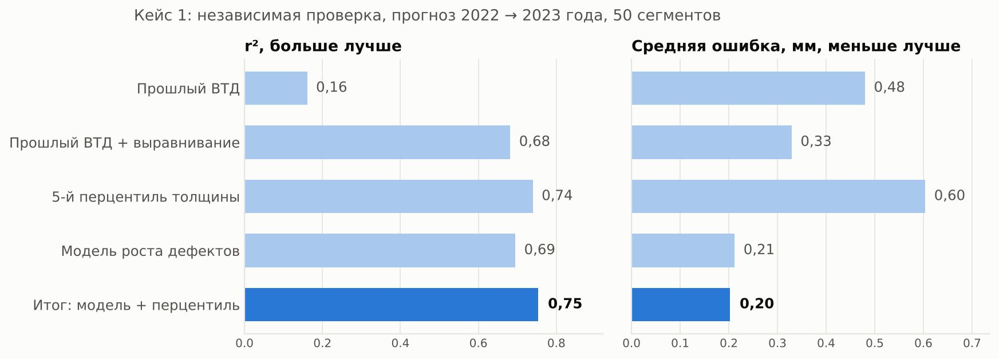
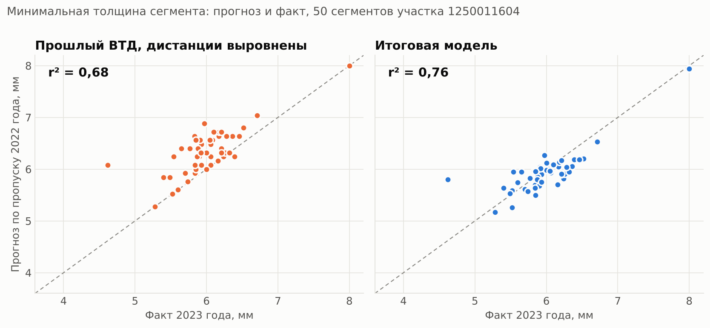
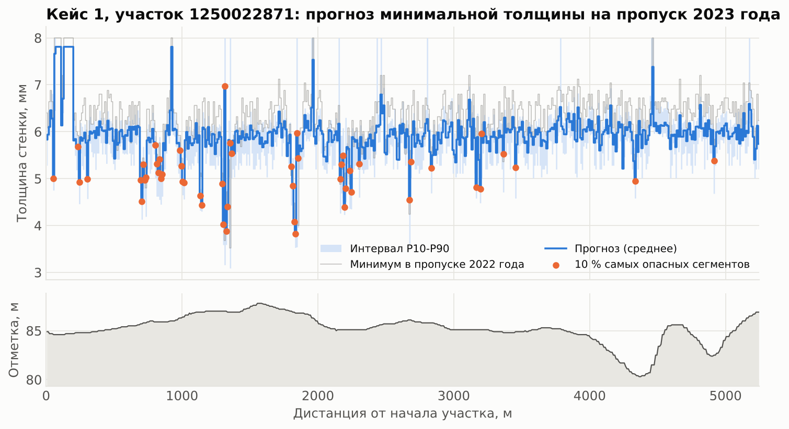
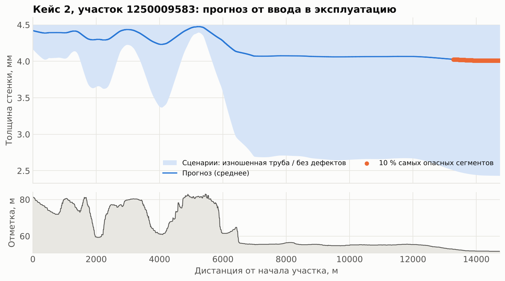

# NedraSeek

Кейс Nedra Digital «PipeTwin». Прогнозируем минимальную толщину стенки (мм) для каждого 10-метрового
сегмента трубы, то есть что покажет следующий пропуск ВТД.

- Кейс 1, участок `1250022871`, T = 01.12.2023. Есть прошлый пропуск 2022 года. На проверке r² 0,75, ошибка 0,20 мм.
- Кейс 2, участок `1250009583`, T = 01.07.2022. ВТД на участке не было, считаем по рельефу. Проверить нечем,
  ожидаем r² 0,01-0,1.

Ответ в `result.csv`, 2 000 строк (525 сегментов кейса 1 и 1 475 кейса 2).

## Запуск

```bash
pip install -r requirements.txt
python scripts/run_pipeline.py    # ~10 с, пишет result.csv и outputs/
python scripts/make_figures.py    # графики в outputs/figures/
python -m pytest -q               # 14 тестов, ~30 с
```

Данные уже лежат в `data/raw/`. Seed в `config.yaml`, при повторном запуске `result.csv` получается тот же
байт в байт. Python 3.12+, pandas 2.2+.

Для Colab есть `notebooks/run_all.ipynb`: скачать репозиторий ZIP-архивом, закинуть в «Файлы» и выполнить ячейки.

## Кейс 1

Проверяли на соседнем участке `1250011604`, где есть оба пропуска, 2022 и 2023. Резали его на 5 блоков по
10 сегментов и прятали по одному. Данные 2023 года из спрятанного блока не участвуют ни в сдвиге, ни в законе
роста (на это есть тест).



| Подход | r² | Ошибка, мм | Нашли из 5 худших |
|---|---|---|---|
| Прошлый ВТД как есть | 0,16 | 0,48 | 1 |
| Прошлый ВТД с выравниванием дистанций | 0,68 | 0,33 | 2 |
| 5-й перцентиль толщины по дефектам сегмента | 0,74 | 0,60 | 2 |
| Модель роста дефектов | 0,69 | 0,21 | 3 |
| **Модель + перцентиль (итог)** | **0,75** | **0,20** | **3** |

Главное здесь выравнивание. Одометры 2022 и 2023 годов расходятся на 2-13 м, и без поправки дефекты уезжают
в соседний сегмент. По r² итог почти как перцентиль, но в миллиметрах ошибается втрое меньше. Сегментов на
проверке всего 50, по блокам r² гуляет от 0,3 до 0,9.



Интервал P10-P90 на проверке накрыл 80 % фактов.

Как считаем:

1. Номера труб между швами в пропусках 2022 и 2023 годов совпадают. По началам 57 общих труб на соседних
   участках сдвиг 1,8 м в начале трубопровода и 7,5 м сразу за целевым участком. Внутри целевого
   интерполируем.
   
2. На паре 2018/2022 сдвиг известен по всему целевому участку, от прямой он отходит примерно на 1 м. Эту
   ошибку разыгрываем.
3. На соседних участках сопоставляем дефекты двух пропусков (2 772 пары) и смотрим, как меняется глубина,
   сколько дефектов не подтверждается и сколько появляется новых.
4. Разыгрываем это 1 000 раз на 26 тыс. дефектов целевого участка. Среднее минимума даёт прогноз, процентили
   дают интервал.
5. Итог: среднее модели и 5-го перцентиля в стандартизованных единицах. Интервал расширяем на эту поправку,
   прогноз ограничен толщиной стенки.

Ремонты. Отчёт 2022 года предписал вырезать три трубы на целевом участке («врезка катушки», дефекты 50-56 %).
Факта ремонта в данных нет, но с худшей трубой после 2018 года так и было. Поэтому считаем, что каждую из
трёх заменили с вероятностью 0,8. Это 7 сегментов, варианты «не меняли» и «поменяли все» лежат в
`outputs/case1_segments.csv`.



Чем старше прошлый пропуск, тем меньше от него толку:


Независимо проверен только горизонт 1,4 года, точки 3,8 и 5,2 года для сравнения.

## Кейс 2

Режим один на весь участок, поэтому сегменты различаются только рельефом. Проверили 11 признаков рельефа на
ВТД других трубопроводов до T. Связь есть только у высотной отметки, сглаженной в окне 1 км, остальное шум.

| Трубопровод | ВТД | Сегментов | r² отметки |
|---|---|---|---|
| Куст-1 - ДНС-1 | 2018 | 575 | 0,08 |
| УЗ-1 КПСОД - ДНС-1 | 2014 | 428 | 0,09 |
| УЗ-3 КПСОД - УЗ-4 | 2023 (после T, только для справки) | 2 172 | 0,01 |


Знак связи на разных трубах разный, поэтому ничего не обучаем: прогноз линейно зависит от сглаженной
отметки, а r² от знака не зависит. Сделали так, что в низинах тоньше. Масштаб потерь (в среднем 21 %,
90-й перцентиль 39 %) взят с тех же старых ВТД.

По целевому участку идёт товарная нефть, как по УЗ-3, а там коррозии почти нет и провалы в основном
заводские. Так что высокого r² здесь не будет. Интервал в кейсе 2 сценарный: снизу «как изношенные трубы»,
сверху «дефектов нет».



## Опасные сегменты

`outputs/top10_segments.csv`: 10 % сегментов каждого участка с самой низкой P10 относительно стенки.
`outputs/top10_intervals.csv`: то же, склеенное в отрезки для выезда. Начало для кейса 1:

| Сегмент | Дистанция, м | Прогноз, мм | P10 | P90 |
|---|---|---|---|---|
| 135 | 1 350-1 360 | 5,71 | 3,09 | 8,00 |
| 131 | 1 310-1 320 | 7,00 | 3,17 | 8,00 |
| 183 | 1 830-1 840 | 3,80 | 3,49 | 4,10 |
| 184 | 1 840-1 850 | 6,01 | 3,53 | 8,00 |
| 130 | 1 300-1 310 | 4,01 | 3,57 | 4,30 |

У 131, 135 и 184 широкий интервал, это трубы под замену. В первую очередь смотреть 1 290-1 360 м и 1 800-1 860 м.

## Очистка данных

| Что | Что сделали |
|---|---|
| В ВТД кроме дефектов швы, арматура, вмятины | Оставили записи с остаточной толщиной и глубиной (убрали 347 из 48 291) |
| В 2018 году глубина долей (0,18), в остальных процентами | Умножили на 100, сверили с толщиной |
| «внутр.» и «Внутренний» | Свели к одному флагу, в минимум идут и внутренние, и внешние |
| Дистанции пропусков расходятся на 2-13 м | 2022 и 2023 совмещаем по началам труб, 2018 по плотности дефектов |
| Отрицательные дистанции и записи за концом участка (~250) | В первый и последний сегмент |
| Скачок сдвига с 7,5 до 13 м на двух трубах под кожухом на 1250011604 | Учтён, раз сдвиг берём по трубам |
| Сегмент без дефектов (15 из 525) | Толщина стенки по снаряду, если нет, то по паспорту |
| ВТД УЗ-1 в декабре 2014, а участки введены в 2016 | Видимо, это прежняя труба. Берём с неё только масштаб потерь |
| УЗТ, 67 замеров по 11-16 мм при стенке 4,5-8 мм | С ВТД не сходится, не используем |
| Повторы точек профиля | Усредняем |

Номер сегмента `floor(Distance / 10)`, всего `floor(L / 10) + 1`, последний неполный.

## Что в outputs/

- `result_with_intervals.csv`: прогноз с P10-P90
- `top10_segments.csv`, `top10_intervals.csv`: опасные сегменты
- `validation_case1*.csv`, `approaches.csv`, `horizons_case1.csv`: проверка кейса 1
- `validation_case2.csv`: признак кейса 2 на других трубах
- `joint_shifts_case1.csv`, `drift_linearity_case1.csv`, `repairs_case1.csv`: сдвиги и ремонты
- `case1_segments.csv`, `case2_segments.csv`, `summary.json`: всё по сегментам и главные цифры

## Ограничения

- Кейс 1 проверен на 50 сегментах одного участка.
- Сдвиг внутри целевого участка не измерен, а интерполирован на 5 км.
- Вероятность ремонта 0,8 это допущение, данных о ремонтах нет.
- Снаряды 2022 и 2023 годов по-разному мерят глубину, отделить это от коррозии нельзя.
- Кейс 2 по сути не проверить, масштаб потерь взят с обводнённых труб и скорее завышен.

Презентация: `presentation/NedraSeek.html`.
